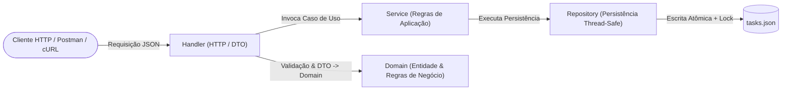

# 📋 Tasker API

<div align="center">


<p align="center">
  <b>Uma API RESTful em Go para gerenciamento de tarefas, projetada com foco em boas práticas, desacoplamento e robustez da Standard Library.</b>
</p>

[Sobre](#-sobre-o-projeto) •
[Destaques](#-principais-destaques-de-engenharia) •
[Arquitetura](#-arquitetura-e-design) •
[Estrutura](#-estrutura-de-pastas) •
[Como Executar](#-como-executar) •
[Endpoints da API](#-documentação-da-api) •
[Próximos Passos](#-roadmap--evolução)

</div>

---

## 🎯 Sobre o Projeto

O **Tasker** faz parte de uma série de projetos de portfólio desenvolvidos para demonstrar o domínio de **Go (Golang)** moderno e os princípios de design de software backend de alta qualidade.

O objetivo deste projeto é construir um serviço REST simples em escopo funcional, porém **robusto na engenharia**: sem frameworks pesados desnecessários, utilizando o roteador nativo aprimorado da standard library do Go (`net/http`), com separação clara de responsabilidades, injeção de dependência e persistência concorrente segura (*thread-safe*).

---

## 💡 Principais Destaques de Engenharia

- **Standard Library First**: Roteamento e servidor HTTP construídos exclusivamente com `net/http` do Go moderno, sem dependência de frameworks web pesados (como Gin ou Fiber).
- **Injeção de Dependências & Inversão de Controle**: Cada camada depende apenas de contratos e interfaces (`domain.Repository`, `handler.TaskService`), facilitando testes unitários com mocks e futura troca de banco de dados.
- **Camada de Domínio Rica**: Validação das regras de negócio encapsulada na própria entidade (`domain.NewTask`).
- **Segurança Concorrente (Thread-Safety)**: Repositório com controle de acesso simultâneo via `sync.RWMutex` para garantir integridade durante leituras e escritas concorrentes.
- **Escrita Atômica em Disco**: Persistência em arquivo JSON com salvamento temporário (`.tmp`) e renomeação atômica (`os.Rename`), prevenindo corrupção de dados em caso de falha durante a gravação.
- **Clean Architecture / Package by Layer**: Estrutura orientada ao padrão canônico de projetos Go com diretórios `cmd/` e `internal/`.

---

## 🏗 Arquitetura e Design

O fluxo de dados segue a arquitetura em camadas tradicionalmente adotada em ecossistemas Go:



1. **Handler (`internal/handler`)**: Recebe payloads HTTP, deserializa JSON e valida requisições com os DTOs.
2. **DTO (`internal/dto`)**: Separa a representação de rede dos objetos de domínio interno.
3. **Domain (`internal/domain`)**: Define a entidade `Task`, regras de validação intrínsecas e interfaces dos repositórios.
4. **Service (`internal/service`)**: Coordena os casos de uso da aplicação e interage com o repositório.
5. **Repository (`internal/repository`)**: Implementa a interface de persistência (JSON thread-safe).

---

## 📂 Estrutura de Pastas

```text
tasker/
├── cmd/
│   └── main.go                 # Ponto de entrada (setup, injeção de dependências e inicialização HTTP)
├── internal/
│   ├── database/               # Configuração e inicialização de banco de dados
│   ├── domain/
│   │   └── task_model.go       # Entidade Task, fábrica de criação e interface do Repository
│   ├── dto/
│   │   └── task_dto.go         # Modelos de requisição e resposta da API
│   ├── handler/
│   │   └── task_handler.go     # Manipuladores de requisições HTTP (rotas GET e POST)
│   ├── repository/
│   │   └── task_repository.go  # Implementação de persistência JSON com atomicidade e Mutex
│   └── service/
│       └── task_service.go     # Camada de lógica de aplicação / orquestração
├── go.mod                      # Módulo Go e dependências
├── go.sum                      # Checksums das dependências
└── README.md                   # Documentação do projeto
```

---

## 🚀 Como Executar

### Pré-requisitos

- [Go](https://go.dev/dl/) instalado (versão 1.22 ou superior recomendada)
- Git instalado

### Passo a Passo

1. **Clone o repositório:**
   ```bash
   git clone https://github.com/marcosx3/tasker.git
   cd tasker
   ```

2. **Baixe as dependências:**
   ```bash
   go mod download
   ```

3. **Inicie o servidor:**
   ```bash
   go run cmd/main.go
   ```

   O servidor iniciará na porta `9000`:
   ```text
   Upando servidor Go!
   Servidor rodando na porta: 9000
   ```

---

## 📡 Documentação da API

A API escuta por padrão em `http://localhost:9000`.

### 1. Criar uma Nova Tarefa

- **Endpoint:** `POST /tasks`
- **Headers:** `Content-Type: application/json`

#### Exemplo de Requisição (cURL)

```bash
curl -X POST http://localhost:9000/tasks \
  -H "Content-Type: application/json" \
  -d '{
    "title": "Aprender Concorrência em Go",
    "status": "in-progress"
  }'
```

#### Resposta de Sucesso (`201 Created`):

```json
{
  "ID": "4f55bb8a-13fa-4b13-b552-32b5003b6d08",
  "Title": "Aprender Concorrência em Go",
  "Status": "in-progress"
}
```

---

### 2. Listar Todas as Tarefas

- **Endpoint:** `GET /tasks`

#### Exemplo de Requisição (cURL)

```bash
curl -X GET http://localhost:9000/tasks
```

#### Resposta de Sucesso (`200 OK`):

```json
[
  {
    "ID": "4f55bb8a-13fa-4b13-b552-32b5003b6d08",
    "Title": "Aprender Concorrência em Go",
    "Status": "in-progress"
  }
]
```

---

## 🗺 Roadmap / Evolução

- [ ] Implementação de novos endpoints (`GET /tasks/{id}`, `PUT /tasks/{id}`, `DELETE /tasks/{id}`)
- [ ] Implementação de repositório com **SQLite** utilizando o driver já referenciado
- [ ] Testes unitários para as camadas de `domain`, `service` e `handler`
- [ ] Middlewares de logging estruturado e tratamento de panic/recovery
- [ ] Containerização da aplicação com Docker e Docker Compose

---

## 👨‍💻 Autor

Desenvolvido por **Marcos** como parte de uma série de projetos de portfólio em Go.

[](https://github.com/marcosx3)
